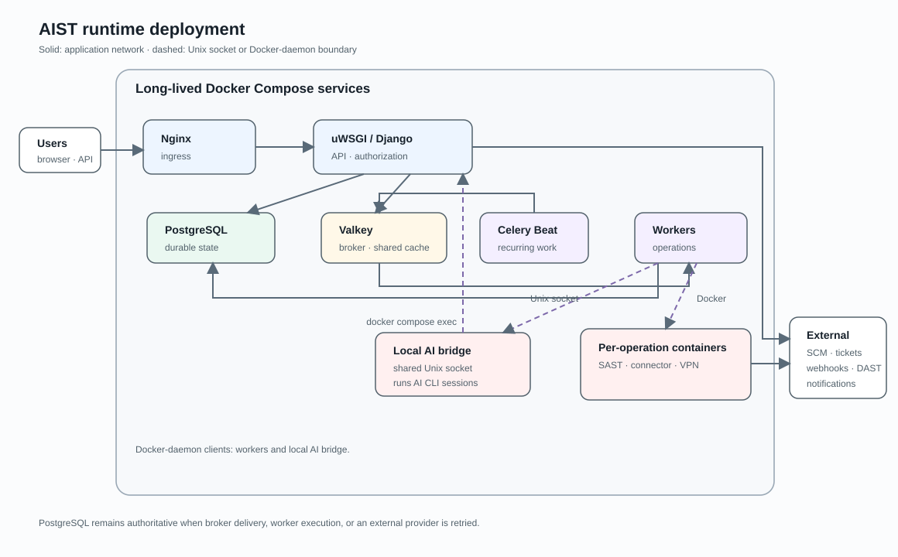

# Runtime deployment

AIST runs as a Docker Compose application. The diagram distinguishes long-lived
services from containers created for one operation. This matters operationally:
the local AI bridge must be healthy before local AI-assisted work can complete,
even though it does not serve browser traffic.

## Long-lived services

Nginx is the application entry point. It serves or proxies browser and API
traffic to the uWSGI/Django service. Django authenticates the request, applies
the product workflow, reads or writes PostgreSQL, and publishes background work
through Valkey.

The long-lived deployment contains:

| Service group | Runtime responsibility |
|---|---|
| Nginx and uWSGI/Django | Browser/API ingress, authorization, and control-plane workflow |
| PostgreSQL and Valkey | Durable product state and Celery delivery |
| Celery Beat and workers | Recurring production and asynchronous execution |
| Local AI bridge | Unix-socket API that runs local AI CLI sessions in its own container |

The bridge has the repository and workspace mounts it needs to launch the CLI.
A skill writes its results through the platform's Django shell, which it reaches
as a Docker-daemon client; a triage session's completion returns to the worker
that waits on the socket call. The CLI runs inside the bridge
container as a non-root user that is also a Docker-daemon client, and reads the
repository mount through the checkout's owning group. The bridge refuses to
start when that user cannot open the checkout directory or its `.env`.

## State and queued work

PostgreSQL stores the durable product and execution state used by both Django
and workers. Valkey transports Celery tasks. Celery Beat publishes recurring
tasks to the same broker, and Celery workers consume them.

The database, not the broker or worker process, determines the lasting state of
a launch, pipeline, finding, or integration. This lets the application expose a
consistent history when a task is retried or a worker restarts.

Work handed to a worker is answered after the request that asked for it has
ended, so Valkey also holds the short-lived values that have to cross a process
boundary: what a worker produced for the request that dispatched it, and the
windows that keep several replicas from asking for the same work at once. That
store is deliberately separate from the per-process caches the application
keeps for itself, and nothing authoritative is in it — an unreachable Valkey
reads as empty, which costs a repeated call or an answer an operator has to
look for elsewhere, never product state.

## Per-operation containers

Celery workers have Docker-daemon access for SAST, connector, and VPN
containers. The local AI bridge also has Docker-daemon access: the CLI it runs
reaches the application containers through Docker Compose. The web process does
not have that socket. Work that
needs it — starting an operation's containers, signalling them when an operator
stops a run, or any call that must leave through an integration's VPN sidecar —
is therefore dispatched to a worker instead of being performed in the request
that asks for it.

Workers reach the bridge through a shared Unix socket. SAST runs create a
workspace plus builder and analyzer containers. A standalone provider run
creates its connector. When private connectivity is selected, that operation
also receives an execution-specific VPN sidecar or a warm scoped proxy.

The shared pipeline execution package is loaded by the workers; it is not an
additional long-lived Compose service. Its registry selects the SAST runtime or
standalone-provider runtime that creates the operation containers.

Selecting a VPN route is fail-closed: if its usable configuration is absent,
the operation fails instead of silently using the host's direct route.

## External boundaries

SCM systems, work-item providers, notification services, AI webhooks, and DAST
gateways are outside the Compose deployment. The owning integration determines
credentials and, where supported, the organization VPN route. Returned reports
and callbacks re-enter through a validated platform boundary before they become
durable state.

## Scaling and trust

Web and worker replicas may share PostgreSQL and Valkey, but every replica must
use the same application configuration and database schema. Capacity for
long-running execution must leave workers available for dispatch, cancellation,
cleanup, and unrelated pipelines. A pipeline in local AI triage holds one worker
process for all its batch sessions, each up to `AIST_LOCAL_TRIAGE_TIMEOUT`, so
worker concurrency is sized for scans and triage together. The broker's
visibility timeout exceeds that session timeout; it is also how long any message
a lost worker held waits before it is delivered again.

The Docker socket is a privileged host boundary: workers and the local AI
bridge can control containers on that host. Production deployments should
isolate those services, restrict deployable images, and limit access to the
socket. See [security boundaries](../security/threat-register.md) and
[pipeline execution runtime](sast-pipeline-runtime.md).
