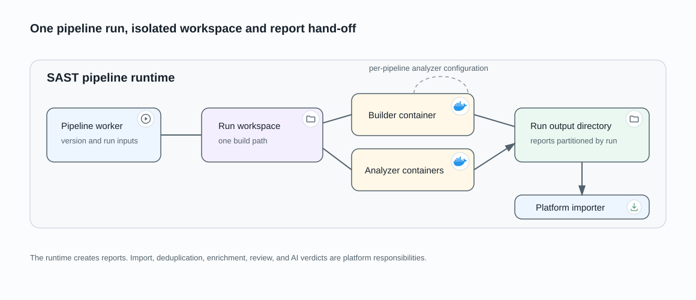

# Pipeline execution runtime

The `sast-pipeline` package is the worker's container-execution boundary for
SAST and standalone providers such as DAST. It is not a separate long-lived
service. AIST owns durable authorization, admission, lifecycle state, and result
import; the package owns provider invocation, operation-container cleanup, and
bounded runtime outcomes.

## Hand one durable execution to a worker

AIST first uses its execution-driver registry to validate the selected target,
acquire capacity, and persist an **Admitted** pipeline with a recoverable publish
intent. The broker message contains only the pipeline identity. A worker accepts
one matching delivery, moves the pipeline to **Executing**, and reconstructs the
frozen execution input from PostgreSQL.

This keeps tenant authority, credentials, parameters, and provider checkpoints
out of the broker payload. A duplicate or stale delivery cannot start an
unrelated execution.

## Select the runtime path

Inside the worker, the AIST driver selects the lifecycle behavior for the
pipeline type. The execution package then uses its own registry to invoke one
runtime path:

- **SAST** prepares the standard execution workspace and output directory, runs
  the builder, then fans out to the selected analyzer containers;
- **DAST** uses those same prepared paths, creates a connector container that
  starts or resumes one external provider run, and returns a bounded outcome
  plus its recovery checkpoint.

The builder prepares source and dependencies through the project's init script.
AIST owns the versioned pair of init script and builder base image and freezes
the selected revision at admission. It passes both to the execution package as
explicit inputs. The package applies the image to its shared builder Dockerfile
before executing init; it has no knowledge of project identity or revision
storage. The shared builder currently requires an Ubuntu/Debian-compatible base.
Each builder starts from its own build's immutable image ID, so another build
replacing the shared image tag cannot change its selected environment.
See [project configuration](../product/project-and-source-onboarding.md#which-script-a-run-uses)
for revision selection and image pinning.
Analyzer selection comes from languages, time class, and launch configuration.
Source analyzers consume the prepared workspace in their own containers.

Build analyzers can declare a separate tool runtime and capture adapter. The
execution package reserves a run-scoped Docker volume and mounts it read-only
in the builder. After init selects the build analyzer, the package populates the
volume from its image. Skipped build analyzers do not require their images to be
built or run. Tools remain owned by analyzer images;
project init installs only project dependencies and supplies a build command.
After init, the adapter executes in the builder with its exported environment,
installed toolchain and filesystem. It writes capture artifacts to temporary
storage shared through a Docker volume. A separate container from the same resolved analyzer image then reads
those artifacts and produces the report. Sharing workspace mounts alone would
not preserve the builder's installed dependencies or environment.

This capture path is currently implemented for C/C++ CodeQL. Other build
analyzers retain their existing execution paths until their images provide a
compatible runtime and adapter. The execution package contains no project or
build-system target knowledge: project configuration chooses the build commands
and native target or preset selection. An analyzer runtime must support the
builder's architecture and system libraries.

Capture covers the compilation actually performed by the supplied command.
Incremental or cached builds can omit source files, and success does not certify
every platform, target or extractor diagnostic. Compatible targets can share
one capture; incompatible configurations require separate runs. Container CPU
and memory limits are configurable independently for builder and analysis;
setting a limit does not supply physical worker capacity. The upstream package
README documents the configuration contract.

When source acquisition needs a project VPN, the builder joins the
execution-specific VPN sidecar. Analyzer containers consume the prepared
workspace and do not automatically inherit that private network path.

When the project resolves to a [build environment](../integrations/build-environment.md),
AIST decrypts its variables for one run and passes them to the execution package
apart from the launch parameters. Before the builder starts, the package refuses
a name that the builder reserves or that the launch environment also sets; it
then adds the variables to the builder's environment and masks their values in
the relayed builder output. Everything that runs inside the builder — init,
the build command and the files it executes, and a build-capture adapter — sees
them. Separate analyzer containers receive only the variables each analyzer
declares by name, so they do not inherit the builder's environment wholesale.

For every container it starts, the package hands environment values to Docker
through an owner-only environment file in a private temporary directory, removed
once the container exits, rather than on the command line or in the Docker
client's own environment. A name or value such a file cannot carry, such as a
value with a line break, fails the run before the container starts.

The builder runs as root and mounts the worker host's Docker socket to start
analyzer containers, so the code a build executes holds the worker's
Docker-daemon trust; see [security boundaries](../security/threat-register.md).

The connector receives its command, its provider token, and its output directory
as owner-only files rather than environment variables, so the worker and the
container must agree on who that owner is. The worker hands ownership to the
unprivileged user the connector image declares; where it cannot, the container
runs as the worker instead. Neither path relaxes the file modes.

## Hand reports back to AIST

SAST analyzers write reports to the timestamped run output directory. When DAST
reaches a terminal outcome, the execution package atomically writes the report
from the typed connector result into the same product/version/pipeline/timestamp
layout and returns its path. AIST persists the provider checkpoint before it
reads and imports that file. The platform importer validates the selected
format, records tests on the pipeline, and creates findings in the pipeline
project's own product for the effective project version; deduplication matches
them against earlier findings afterwards.

After report hand-off and container cleanup, the report remains in durable
pipeline output while connector credentials and recovery files are removed with
the execution workspace. AIST owns deduplication, enrichment, regression
detection, review, and AI triage.

## Recover without changing the boundary

The launch reconciler repairs stale dispatcher claims, durable publish intents,
and execution leases from PostgreSQL. If an accepted DAST task disappears while
the provider outcome remains recoverable, AIST republishes the same generic task
with the stored checkpoint. A lost SAST task cannot safely resume midway and
finishes with warnings instead.

A connector that fails before it reaches the provider — an unreadable command
file, an unusable token, an output directory it cannot write — is not a provider
outage: the next attempt would fail identically. AIST ends such a pipeline at
once with its own outcome code instead of retrying it.

An external provider run becomes terminal only after an explicit domain outcome.
Transport failures and unresolved stop requests remain recoverable, with no
retry-count limit. Progress timestamps support observation; silence or elapsed
duration alone does not terminate the run. When the provider becomes reachable,
the next attempt can observe its terminal outcome and import the result through
the normal finalization path.

Containers and temporary paths remain scoped to one pipeline. Tool runtime
volumes are removed after the builder exits; cancellation also reclaims volumes
labeled for that pipeline once their containers have stopped. Capture artifacts
are removed after each analyzer, including failed runs; their anonymous Docker
volume is reclaimed when its containers are removed. Final reports remain in
run output. SAST cancellation stops local work. DAST
cancellation persists intent first, then the
connector carries the stop request across the provider boundary until a terminal
outcome is observed.

See [pipeline execution](../product/pipeline-execution.md) for the user-visible
lifecycle and [VPN-routed operations](../data-flows/vpn-routed-operations.md)
for the conditional network path.
