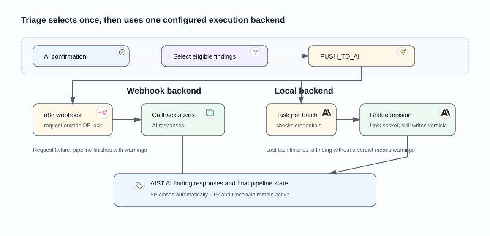

# AI triage execution

AI triage begins after imported findings are ready for review. AIST first
selects a set of findings, then sends that same set through the configured
execution backend. Selection and backend choice are independent decisions.

## Select findings

Automatic selection applies the rules captured when the pipeline was launched.
Manual selection lets an authorized reviewer choose findings from the pipeline.
Findings that already contain an analyzer-produced AI verdict are excluded from
post-import automatic selection.

If no findings remain after selection, the pipeline completes without creating
an AI request.

## Execute through the selected backend

Webhook mode sends project context, the selected finding identifiers, the
pipeline identity, and a callback address to the configured n8n webhook. The
accepted callback persists the resulting AI responses. A failed request leaves
the pipeline with a visible degraded outcome.

Local mode splits the selected findings of the pipeline into batches of
`AIST_LOCAL_TRIAGE_BATCH_SIZE`; only findings of the pipeline itself enter a
batch, and the pipeline log counts the selected findings of other pipelines that
are left out. A selection with none of the pipeline's findings finishes with
warnings; one whose findings all have a verdict or are closed finishes without
triage. A Celery chain
then triages the batches one after another: each task asks the local AI bridge,
through the shared Unix socket, to run one CLI session for its batch and waits
for it to end, so a session handles at most one batch whatever the size of the
pipeline. Each session is given the identifiers of its own findings. The last
task of the chain finishes the pipeline, with a visible degraded outcome when
any finding sent to a session has no AI response for the pipeline, whatever the
sessions reported. A batch without credentials or with a failed session is
still completed, so its findings count as untriaged rather than stopping the
chain. When the push or the chain cannot be queued, the batches are cancelled
and the pipeline finishes with warnings.

Stopping the pipeline cancels its pending batches, which the chain then skips. A
batch whose session is running is cancelling until the session ends, and only
then cancelled: until then the pipeline keeps its sources and cannot be
deleted. A batch task delivered a second time, after its batch has ended, runs
no session and ends its copy of the chain.

An operator can triage the findings of a finished, locally triaged pipeline that
hold no AI response for it with the `retriage_pipeline` management command, run
in the worker container that holds the sources. It takes every active finding
without an analyzer-produced verdict, regardless of the launch's selection
rules, and sends it through the same batches. The pipeline keeps its sources
until those batches end and keeps its status; the outcome, including findings
still without a response, is reported in the pipeline log. A retriage that
cannot be queued cancels its batches and reports the error, so it can be run
again.

## Persist the verdict

Each response is associated with the originating pipeline and finding. A false
positive verdict closes and marks the finding false positive in the normal
callback flow. True positive and uncertain findings remain active for human
review.

The AI response does not remove reviewer authority. An authorized reviewer can
later change the finding disposition according to the normal review workflow.
See [AI triage](../product/ai-triage.md) and
[finding review](../product/finding-review.md).
