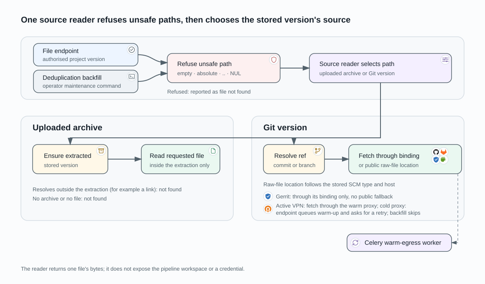

# Source File Access

This flow reads a single source file of a stored project version. Two consumers
use it: the file endpoint, which returns the file to an authorised AIST user,
and the deduplication backfill, an operator maintenance command that
fingerprints the source lines older findings point at, so a finding whose code
moved between versions can still be recognised as the same finding. Both go
through one reader, so a file is located, guarded, and fetched the same way for
either. An uploaded archive is read from its extracted project-version
directory; a Git version is fetched from its repository at the selected ref.

## Start with an authorised version

The file endpoint resolves the requested project version from an authorised
project-version queryset with product view permission. The requested path is
used only after that version is selected. A caller cannot choose a VPN tunnel,
repository binding, or organization by request parameter. The backfill reads
the version and path recorded in each finding's stored source link.

## Refuse a path outside the source

Before any source is read, the reader refuses a path that is empty, absolute,
contains a parent-directory (`..`) segment, or contains a NUL character. The
check is the same for an archive and a repository, and a refused path is
reported as a missing file: the endpoint returns not found and the backfill
skips the finding.

## Read an uploaded archive

For a `FILE_HASH` version, AIST extracts the stored archive on first need and
reads the requested file from that extraction; the endpoint streams it rather
than loading it whole. A file that resolves outside the extraction root, for
example through a link, is treated as absent, and so is every file of an
archive that cannot be extracted. If the version has no archive or the
requested file is unavailable, the endpoint returns not found.

## Fetch a Git version

For `GIT_BRANCH`, the reader uses the last resolved commit when present and
otherwise the configured branch. For `GIT_HASH`, it uses the stored version
value. The ref must be a valid Git ref name: a version whose ref is not, for
example one with a `..` component, is refused on creation, and a file request
against such a stored ref is reported as a missing file without contacting the
host. A pipeline workspace is never used because pipeline workspaces are
per-run and ephemeral.

The repository's stored SCM type and host decide where a file is downloaded
from. GitHub and Gitea files come from that provider's raw-file location and
GitLab files through the GitLab API client, with the repository binding's
credentials when the project has a binding and anonymously when it has none. Gerrit content is fetched only
through the Gerrit binding, which decodes Gerrit's encoded file response; a
Gerrit repository without a binding has no public fallback, so its files are
unavailable. A project without a repository has no Git source to read.

## Route VPN-protected source access

For a repository whose source access resolves to an active VPN integration, the
fetch goes through a warm HTTP CONNECT proxy for that VPN, for both consumers. A
Celery worker starts or reuses one warm sidecar per VPN integration; the UI can
ask to prewarm it when findings become visible. If the endpoint's fetch reaches
a cold proxy, it queues a warm-up and returns `202` with a retry interval. The
backfill does not warm the proxy: a file it cannot reach is skipped and counted,
and a later run can annotate it. Public repositories use no proxy.

The warm egress pool is distinct from the short-lived VPN sidecar created for
a pipeline run. Idle warm sidecars are reaped, and the pool also enforces a
maximum count.
