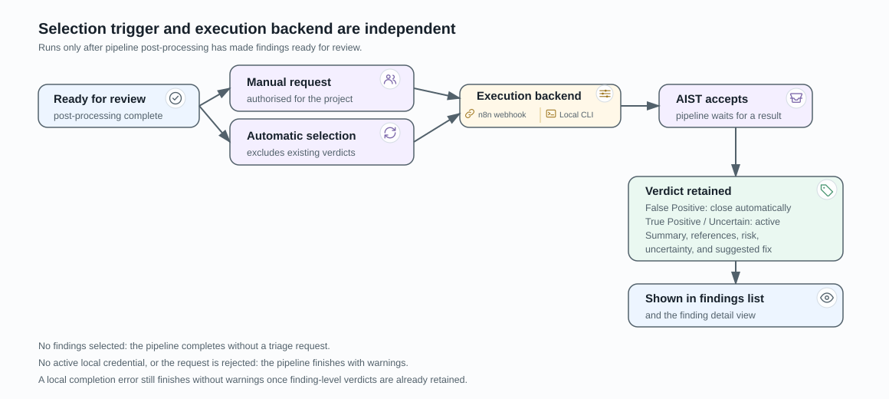

# AI Triage

AI triage adds a finding-level verdict to an imported pipeline result. It runs
only after pipeline post-processing has made findings ready for review. Two
independent decisions control it: findings are selected manually or
automatically, then the selected set is executed through the configured webhook
or local CLI backend.

## Select findings

A manual request is authorised against the pipeline's project and verifies that
each selected finding belongs to that project. Automatic triage selects active
findings after post-processing, applies the saved filter for the execution
backend, and excludes findings that already have an analyzer-produced AI
verdict.

The execution backend is resolved independently of the selection trigger: a
per-launch override takes priority over the project profile. AIST supports two
backends — an **n8n webhook** and a **local Claude bridge** — and either
selection trigger can use either backend. The selection trigger, the backend
the launch resolves to when it is accepted, and the filter snapshot are recorded
with the run, so a later project-profile change does not change where that run's
findings go.

An automatic launch needs a saved filter unless the backend it resolves to —
the launch's own choice, else the project profile's — is the local bridge,
which takes every eligible finding when no filter is set. AIST applies this rule
wherever launch settings are accepted, whether from the run form, the start API,
or a saved launch configuration, and rejects an automatic webhook launch without
a filter instead of starting a run that could select nothing. A run that passes
the rule sends its findings to its recorded backend on its own once
post-processing completes. A saved launch configuration is checked again each
time it launches, so one that no longer passes is rejected at that launch.

## Receive and retain a verdict

When AIST accepts a triage request, the pipeline waits for a result. A result is
stored as one AI response per pipeline and one verdict per finding in that
pipeline. A verdict is `True Positive`, `False Positive`, or `Uncertain`; it can
include summary, references, risk scores, uncertainty values, and a suggested
fix. The findings list and detail view show the saved verdict.

In the normal callback flow a `False Positive` verdict automatically closes the
finding, marks it as false positive, and records the AI action. `True Positive`
and `Uncertain` findings remain active for human review. A reviewer can later
change any of these dispositions through the normal finding controls.

## Failure behaviour

If no findings are selected, the pipeline completes without a triage request.
If the selected local mode has no active credential, or the request cannot be
accepted, AIST finishes the pipeline with warnings. A local completion callback
that reports an error still completes without warnings when finding-level
verdicts were already retained.
