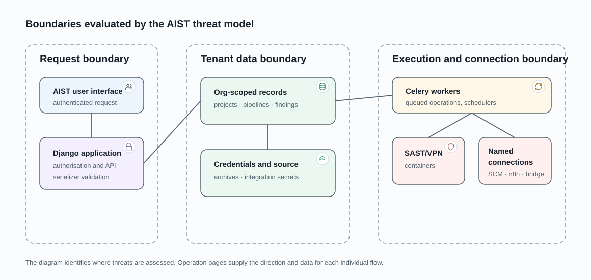
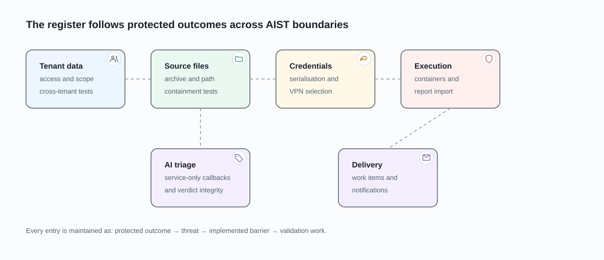

# Security boundaries and trust assumptions

This public threat model describes the assets AIST protects, where untrusted
data crosses a boundary, the security property expected at that boundary, and
the trust that remains with operators or external providers. It is not a list
of active vulnerabilities or a claim of certification.

Suspected vulnerabilities, affected implementation paths, reproduction, and
remediation status are handled privately according to the repository
[security policy](../../SECURITY.md).

## Assets and actors

Protected assets include tenant source code, findings, review decisions,
integration credentials, scan results, and the authority to start or alter
work.

Relevant actors are authenticated users, organization administrators,
deployment operators, external providers, and the untrusted source or report
content processed by scan workloads.

## Boundary model

| Threat scenario | Security property | Residual trust or responsibility |
|---|---|---|
| A user presents an identifier owned by another organization or project | Object lookup is constrained by current tenant, project access, and named permission | Every new endpoint and relationship requires authorization review and cross-tenant tests |
| A bearer token is copied or its owner's access changes | The token is limited to one organization and current owner authority; expiry and revocation are checked on use | Tokens must be protected and rotated; they are not sender-constrained |
| Source archives, repositories, or reports contain hostile input | Parsing and execution occur through bounded import or isolated workload boundaries before durable findings are accepted | An analyzer or provider can still produce inaccurate results; operators choose which providers and images to trust |
| An external provider describes its own run — what it covered, what it spent — alongside the findings | The complete file is size-bounded; an empty or uninterpretable descriptive value is stored as absent and does not participate in authorization. The report's target must equal the selected project binding and its source-repository keys cannot exceed that binding | Coverage and cost figures are the provider's claims about its own work; AIST surfaces a breakdown that contradicts its own total but cannot independently verify what a run actually examined |
| A provider-supplied document describes both a page AIST renders and the requests AIST then sends for an operator | The response is size-bounded before it is parsed, and the document's envelope is shape-checked before anything renders it or acts on it. What AIST constrains is what it addresses, not what it displays: a value or a row it cannot read is cut or left out, and the page reports what it is not showing. The browser supplies only an action name, a row identity, and the fields that action declared. AIST re-reads the row, takes the method and address from the affordance the gateway published for it, discards anything that action did not declare writable, refuses a form field that asks for a credential, and sends only inside that run's own address space on the organization's own gateway | The gateway decides which actions exist, what each one does, and which integrator may send them; AIST relays an authorized operator decision but cannot verify that an action behaves as its description claims. The wording and values the page shows are the provider's own, displayed as text rather than vouched for |
| Repository-supplied names reach an outbound notification channel | Text AIST generates for a message is escaped for the destination's own markup before delivery, so a branch or repository name cannot render as a mention or a disguised link | A description an administrator types on the action is trusted, authored content and is delivered as written; the channel's own membership decides who reads it |
| An integration points AIST at an external or private destination | The organization owns the integration, credentials, and optional VPN route; the consumer selects the route from authorized state | Administrators control the provider endpoint and private ranges made reachable by the VPN |
| A queued task is duplicated, delayed, or executes after access changes | Durable state is authoritative; sensitive transitions revalidate stored authority and accept one execution identity | Database, broker, worker, or provider outages can delay cancellation and terminal observation |
| A launch parameter or provider catalog attempts to carry a credential into durable snapshots or broker data | Ephemeral and saved launch arguments accept only bounded, secret-free parameters; credential-shaped provider schema fields and defaults are rejected. Values the platform derives from an organization integration, such as a run's credentialed source location, are resolved for one run and are not written into a saved launch configuration or a frozen launch request | Provider-side scan credentials remain under provider administration; collecting application credentials in AIST requires a separate encrypted, write-only design; a run still hands its credentialed source location to its own build workload, where container and host isolation are the boundary |
| A DAST integration is disabled or deleted while admission is racing | Admission, disable, and teardown serialize on the integration; teardown requires a disabled, quiescent integration and preserves pipeline and finding history | Administrators must use disable for a reversible stop and wait for active external work to become terminal before teardown |
| A scan, connector, or local AI operation attempts to affect the application host | Workloads run in operation-specific containers without privileged or host-network execution | Workers and the local AI bridge have Docker-daemon access and remain privileged host components requiring isolated, hardened hosts |
| A callback or provider result references the wrong run or tenant object | Callback authentication is combined with stored object identity and ownership validation | Service credentials and conforming external providers remain privileged trust relationships |

## Public and private records

Public documentation should state stable security properties, trust boundaries,
and durable limitations that help administrators deploy and use AIST safely. It
must not publish an unpatched exploit path or work-in-progress remediation.

The private security record owns active findings, exact affected paths,
reproduction, severity, remediation status, and coordinated disclosure. Public
pages are updated after the security property changes or disclosure is safe.

Related pages: [access control and roles](access-control-and-roles.md),
[tenant isolation](tenant-isolation-and-access.md),
[runtime deployment](../architecture/runtime-deployment.md), and
[VPN-routed operations](../data-flows/vpn-routed-operations.md).
